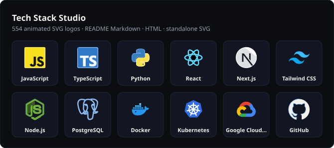
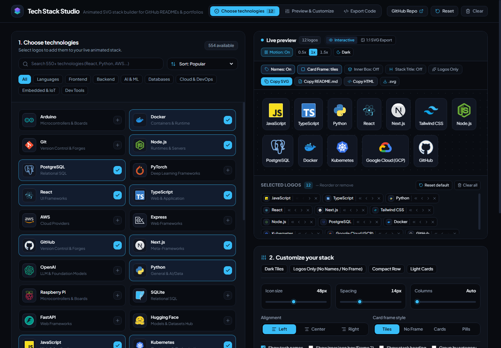
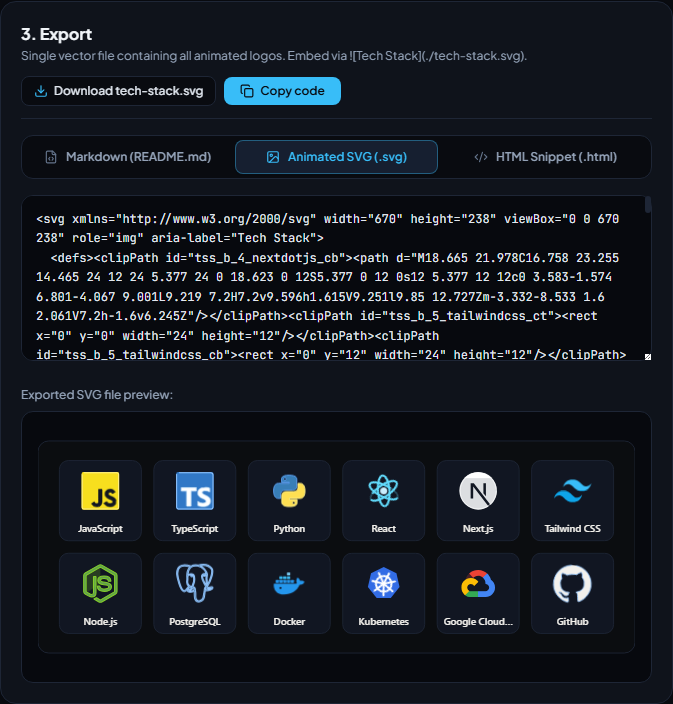

<div align="center">

<a href="https://thanhnguyxnorg.github.io/Techstack-Studio/">
  
</a>

<picture>
  <source media="(prefers-color-scheme: dark)" srcset="docs/assets/wordmark.svg" />
  
</picture>

# Tech Stack Studio

**Compose animated technology stacks. Export them anywhere.**

Build polished animated technology stacks from 554+ logos. Customize motion live, then export README Markdown, standalone HTML, or self-contained SVG.

[](https://thanhnguyxnorg.github.io/Techstack-Studio/)
[](docs/ARCHITECTURE.md)
[](https://github.com/ThanhNguyxnOrg/Techstack-Studio/issues/new/choose)

[](https://github.com/ThanhNguyxnOrg/Techstack-Studio/actions/workflows/ci.yml)
[](https://github.com/ThanhNguyxnOrg/Techstack-Studio/actions/workflows/deploy.yml)
[](LICENSE)
[](CONTRIBUTING.md)

[](https://react.dev)
[](tsconfig.json)
[](https://vite.dev)
[](https://tailwindcss.com)
[](.nvmrc)
[](.prettierrc.json)

[](#catalog)
[](#motion)
[](#exports)
[](https://github.com/ThanhNguyxnOrg/Techstack-Studio/stargazers)
[](https://github.com/ThanhNguyxnOrg/Techstack-Studio/forks)
[](https://github.com/ThanhNguyxnOrg/Techstack-Studio/commits/main)

</div>

---

<div align="center">



<sub>The banner above is produced by the same export function the app uses: one animated SVG, no JavaScript, no external requests.</sub>

</div>

## Why Tech Stack Studio?

Most "tech stack" README banners are static images, a pile of shields, or a
third-party service that can disappear. Tech Stack Studio generates a **real,
standalone SVG** that you own and can commit next to your code.

- **554 verified logos** across 8 engineering domains, each with a static source
  file and an animated standalone file.
- **18 motion families** with brand-aware colors, hand-tuned choreography for
  recognizable marks, and a reduced-motion fallback in every asset.
- **Live preview that matches the export 1:1** — switch between the interactive
  preview and the exact SVG output without guessing.
- **Three export formats** — GitHub README Markdown, standalone HTML, and a single
  animated SVG banner.
- **Zero runtime dependencies** in exported files. They work in an `` tag, a
  README, a portfolio, or a plain HTML page.
- **Private by design** — the app is browser-only; selections never leave your
  machine.
- **Reproducible assets** — catalog, SVGs, and runtime parts are generated from one
  seed table and verified by tests.

## Screenshots

### Compose and customize



### Export in one click



## Quick start

**Requirements:** Node.js 22.12+ and npm 10+.

```bash
git clone https://github.com/ThanhNguyxnOrg/Techstack-Studio.git
cd Techstack-Studio
npm ci
npm run dev
```

Open <http://localhost:3000>. No API keys, database, or environment variables are
needed.

Prefer not to install anything? Use the **[live studio](https://thanhnguyxnorg.github.io/Techstack-Studio/)**.

## How it works

1. **Pick technologies** from the searchable catalog. Filter by category, sort by
   popularity or name, and reorder the selected stack.
2. **Customize the look** — theme, icon size, spacing, columns, alignment, labels,
   inner plates, tile/pill/minimal presentation, and animation speed.
3. **Export** the format you need. Copy it, download it, or paste it straight into
   your README.

Your stack and settings are saved in `localStorage`, so a refresh does not lose
your work.

<a id="catalog"></a>

## Catalog

Everything is bundled: no icon CDN is called at runtime.

| Category              |   Logos | Examples                                             |
| --------------------- | ------: | ---------------------------------------------------- |
| Programming languages |      65 | TypeScript, Python, Rust, Go, C++, Swift             |
| Frontend              |      92 | React, Next.js, Vue, Tailwind CSS, Vite, Svelte      |
| Backend               |      71 | Node.js, FastAPI, Spring Boot, Django, GraphQL       |
| AI & machine learning |      49 | PyTorch, Hugging Face, LangChain, TensorFlow, Ollama |
| Databases             |      48 | PostgreSQL, Redis, MongoDB, DuckDB, Apache Doris     |
| Cloud & DevOps        |      87 | Docker, Kubernetes, Terraform, AWS, GCP, Grafana     |
| Embedded development  |      48 | Arduino, Raspberry Pi, ESP32, STM32, MQTT            |
| Developer tools       |      94 | Git, GitHub, Neovim, Cursor, Figma, Postman          |
| **Total**             | **554** | **8 categories, 50 Tier A entries**                  |

<a id="motion"></a>

## Motion system

Each animated logo is a small, self-contained CSS animation. No JavaScript is
required to play it, and `prefers-reduced-motion: reduce` freezes the artwork
cleanly.

|                       |                      |                     |                         |
| --------------------- | -------------------- | ------------------- | ----------------------- |
| Liquid wave fill      | Stroke trace fill    | Orbital spin        | Dual snake interlock    |
| Container stack slide | Circuit trace pulse  | Node network signal | Flame core flicker      |
| Radar sweep mask      | Shimmer prism sweep  | Segmented assembly  | Curtain vertical reveal |
| Pendulum harmonic     | Pixel grid cascade   | Data stream flow    | Iris aperture bloom     |
| Beacon ripple rings   | Elastic morph bounce |                     |                         |

The generator assigns a family to every catalog entry and records the choice in
[`docs/animation/animation-manifest.json`](docs/animation/animation-manifest.json).
See the [asset pipeline](docs/ASSET_PIPELINE.md) for the full technique table.

<a id="exports"></a>

## Export formats

### GitHub README Markdown

Generates an aligned HTML table with animated SVG images, optional labels, and
links to each technology's documentation. Paste it directly into a profile or
project README.

```html
<!-- Generated with Tech Stack Studio -->
<div align="center">
  <table>
    <tr>
      <td align="center" width="92">
        <a href="https://www.typescriptlang.org/" target="_blank" rel="noreferrer">
          
          <br /><sub><b>TypeScript</b></sub>
        </a>
      </td>
    </tr>
  </table>
</div>
```

### Standalone HTML

A self-contained section with inlined animated SVG markup and inline styles. Drop
it into a portfolio, docs page, or landing page — no build step, no external
stylesheets.

### Animated SVG

One vector banner containing every selected logo. Perfect for a README header,
social card, or slide deck.

```markdown

```

The file is fully self-contained and can be committed to the repository. It uses
`role="img"`, includes a label, and ships with the same reduced-motion fallback.

## Repository structure

```text
.
├─ .github/
│  ├─ ISSUE_TEMPLATE/
│  ├─ workflows/ci.yml
│  ├─ workflows/deploy.yml
│  ├─ CODEOWNERS
│  ├─ PULL_REQUEST_TEMPLATE.md
│  └─ dependabot.yml
├─ docs/
│  ├─ animation/animation-manifest.json
│  ├─ assets/                    # logo, demo SVG, screenshots
│  ├─ ARCHITECTURE.md
│  ├─ ASSET_PIPELINE.md
│  └─ DEPLOYMENT.md
├─ public/
│  ├─ icons/animated/            # 554 standalone animated SVGs
│  ├─ icons/source/              # 554 static source SVGs
│  ├─ icons/reference/           # 29 upstream reference SVGs
│  └─ favicon, manifest, OG image, robots, sitemap
├─ scripts/
│  ├─ buildCatalogManifest.mjs
│  └─ generateStandaloneSvgLibrary.mjs
├─ src/
│  ├─ components/
│  ├─ data/
│  ├─ types/
│  └─ utils/
├─ ATTRIBUTION.md
├─ CONTRIBUTING.md
├─ LICENSE
└─ README.md
```

## Scripts

| Command                    | What it does                                      |
| -------------------------- | ------------------------------------------------- |
| `npm run dev`              | Start the Vite dev server on port 3000            |
| `npm run build`            | Build the production site into `dist/`            |
| `npm run preview`          | Preview the production build                      |
| `npm run typecheck`        | Run TypeScript in strict mode                     |
| `npm test`                 | Run unit and asset-integrity tests                |
| `npm run format`           | Format with Prettier                              |
| `npm run format:check`     | Verify formatting without writing                 |
| `npm run verify`           | Format check + typecheck + tests + build          |
| `npm run generate:catalog` | Rebuild the catalog from its seed table           |
| `npm run generate:icons`   | Regenerate source/animated SVGs and runtime parts |
| `npm run generate`         | Run both generators in order                      |
| `npm run clean`            | Remove `dist/`                                    |

## Asset pipeline

```text
CATEGORY_SEEDS
      │
      ▼
buildCatalogManifest.mjs ──► src/data/generatedCatalog.json  (554 entries)
      │
      ▼
generateStandaloneSvgLibrary.mjs
      ├─► public/icons/source/{id}.svg       (554)
      ├─► public/icons/animated/{id}.svg     (554)
      ├─► src/data/standaloneSvgParts.json   (554)
      └─► docs/animation/animation-manifest.json
```

The generator removes orphan files, validates every SVG, and is idempotent. The
integrity test fails if the catalog, both SVG folders, and the runtime parts drift
apart. Read [docs/ASSET_PIPELINE.md](docs/ASSET_PIPELINE.md) before adding or
renaming a technology.

## Deployment

The site is a static Vite build deployed to GitHub Pages by
[`deploy.yml`](.github/workflows/deploy.yml). A push to `main` runs typecheck,
tests, build, and deploy. The workflow derives the correct base path automatically,
so the same code works at a user root or a project subpath.

```bash
npm run build
npm run preview
```

For first-time setup, custom domains, and troubleshooting, see
[docs/DEPLOYMENT.md](docs/DEPLOYMENT.md).

## Quality gate

```bash
npm run verify
```

This runs Prettier, strict TypeScript, both test suites, and a production build.
CI runs the same steps on Node 22 for every push and pull request. The catalog
suite checks 554 entries, 8 categories, 18 motion families, exact SVG/parts parity,
and rejects scripts, event handlers, raster embeds, `javascript:` URLs, and
external runtime references in generated assets.

## Contributing

Contributions are welcome — new technologies, motion refinements, accessibility
fixes, documentation, and bug reports.

- Read [CONTRIBUTING.md](CONTRIBUTING.md) for setup and the asset workflow.
- Follow the [Code of Conduct](CODE_OF_CONDUCT.md).
- Report vulnerabilities privately via [SECURITY.md](SECURITY.md).
- Browse [good first issues](https://github.com/ThanhNguyxnOrg/Techstack-Studio/labels/good%20first%20issue)
  or open a [feature request](https://github.com/ThanhNguyxnOrg/Techstack-Studio/issues/new/choose).

If you add a logo, include its source and usage terms in the pull request so the
attribution can be reviewed.

## License and attribution

The application code, build scripts, tests, documentation, and original animation
work are released under the [MIT License](LICENSE).

Technology logos and brand assets come from the developer community and remain the
trademarks of their respective owners. Inclusion does not imply affiliation or
endorsement. See [ATTRIBUTION.md](ATTRIBUTION.md) for the contribution and removal
policy.

<div align="center">

## Star history

<a href="https://star-history.com/#ThanhNguyxnOrg/Techstack-Studio&Date">
  <picture>
    <source media="(prefers-color-scheme: dark)" srcset="https://api.star-history.com/svg?repos=ThanhNguyxnOrg/Techstack-Studio&type=Date&theme=dark" />
    <source media="(prefers-color-scheme: light)" srcset="https://api.star-history.com/svg?repos=ThanhNguyxnOrg/Techstack-Studio&type=Date" />
    
  </picture>
</a>

<sub>Built by <a href="https://github.com/ThanhNguyxnOrg">ThanhNguyxnOrg</a> and contributors.<br />If this project saved you time, consider giving it a ⭐.</sub>

</div>
